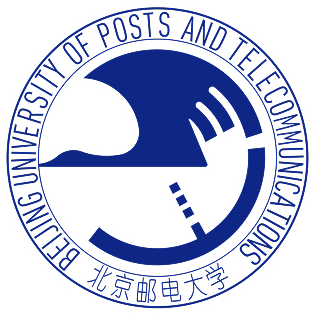
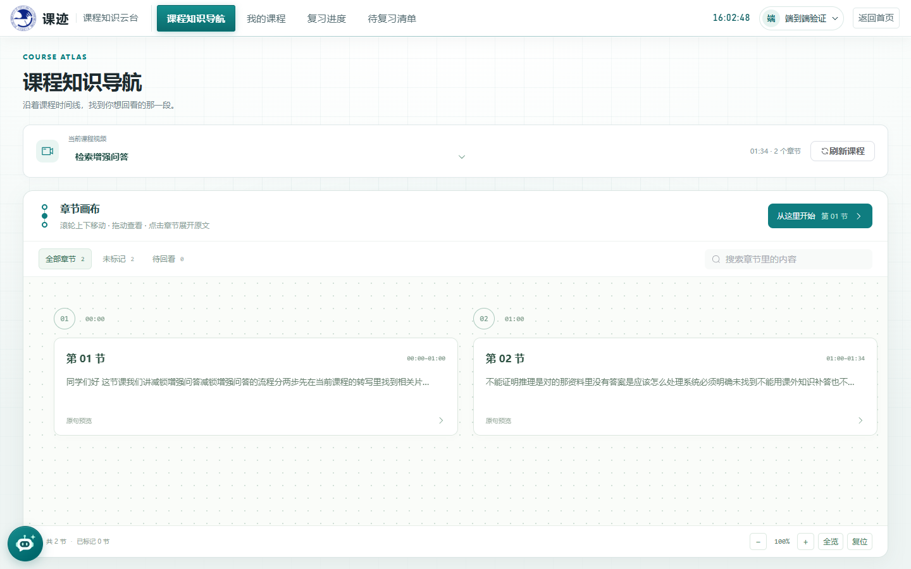
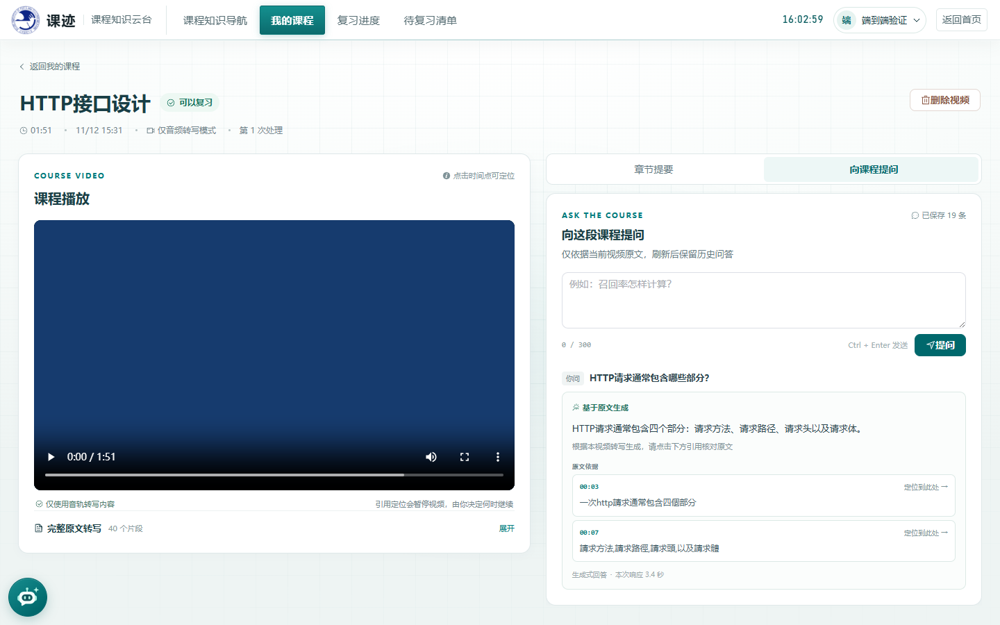
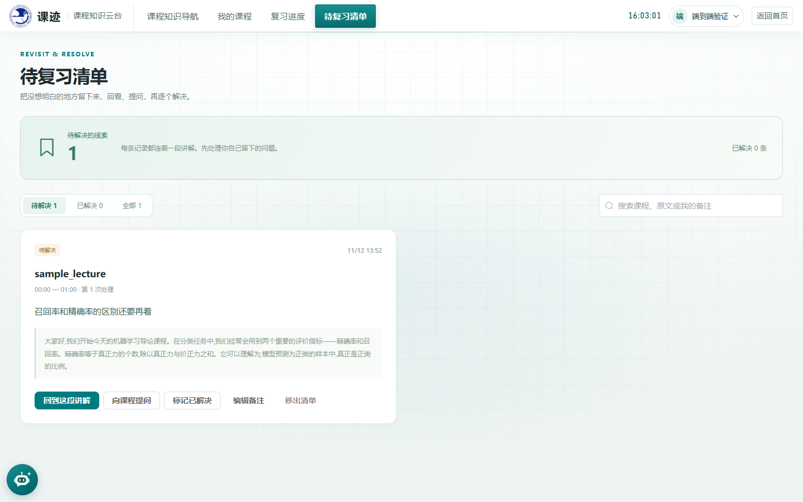

<div align="center">
  
  <h1>课迹 · 课程视频复习助手</h1>
  <p><b>把录课变成可以查找、提问和接着学的复习空间。</b></p>
  <p>北京邮电大学专业实训课设 · 原型最终版</p>
  <p>
    <a href="#功能一览">功能一览</a> ·
    <a href="#快速运行">快速运行</a> ·
    <a href="docs/最终交付/README.md">交付文档</a> ·
    <a href="docs/最终交付/原型最终版验收.md">验证记录</a>
  </p>
</div>

---

上传一段中文课程视频，课迹会生成转写原文与章节导航。遇到疑问时，可以依据当前课程提问、点击引用回看讲解；播放位置、备注和复习标记会随账号保存。



<div align="center"><sub>实际界面截图 · 示例内容来自合成语音课程</sub></div>

## 功能一览

| 你想做的事 | 课迹提供的帮助 |
| --- | --- |
| 快速找到讲过的内容 | 视频转写、章节提要、搜索与时间路线导航 |
| 带着问题复习 | 混合检索 RAG 问答，回答附原文引用，可点击定位 |
| 核对答案是否有依据 | 引用从课程数据库回填；无依据拒答，模型故障明确降级 |
| 下次接着学 | 保存播放进度、已复习标记、待复习清单和备注 |
| 换个浏览器继续 | 登录同一账号、访问同一服务即可恢复学习档案与问答历史 |
| 多人分别使用 | 账号登录、课程归属隔离、会话与写入校验 |

<details>
<summary><b>展开查看：课程问答与复习清单</b></summary>

| 回答有出处 | 复习有记录 |
| :---: | :---: |
|  |  |

</details>

## 快速运行

准备 **Python 3.11、Node.js 22.12+、FFmpeg / ffprobe** 和完整的 **faster-whisper-small** 模型。模型与工具准备见[部署手册](deploy/03_新机冷启动部署手册.md)。

```powershell
git clone https://github.com/saberblade/course-video-assistant.git
cd course-video-assistant
py -3.11 -m venv .venv
.\.venv\Scripts\python.exe -m pip install -r requirements.lock.txt
npm.cmd --prefix frontend ci
if (-not (Test-Path .env.local)) { Copy-Item .env.example .env.local }
```

在 `.env.local` 填写模型 API 与本机工具、模型路径；密钥仅由后端读取，不上传 GitHub。随后执行：

```powershell
npm.cmd --prefix frontend run build
powershell -ExecutionPolicy Bypass -File deploy/start.ps1
```

打开 **[http://127.0.0.1:8000](http://127.0.0.1:8000)**，注册账号后上传课程。启动会自动升级数据库；新版本拉取后应重新安装变更依赖、构建并重启。停止用 `deploy/stop.ps1`，备份恢复见[维护说明](docs/最终交付/迁移备份与维护.md)。

> 视频范围：中文讲课音轨、H.264/AAC MP4，单文件不超过 **200 MiB / 20 分钟**。未配置模型 API 时可使用原文检索降级；转写仍需本地模型与 FFmpeg。

## 原型验证与边界

本轮修复了模型异常输出、问答总预算、队列故障恢复、忙时停服和备份恢复问题；备注保存会等待服务端确认，冲突时保留草稿。

- 后端回归、前端类型检查与生产构建：结果见[本轮验收](docs/最终交付/原型最终版验收.md)。
- 独立数据实测：转写 → 真实向量与模型问答 → 引用与拒答 → 备份 → 干净目录恢复。
- **本次交付是原型最终版**。样本使用合成语音，尚未验证真实录课质量；旧 25 题自动报告主要检查回答状态和引用，不能等同于人工确认全部答对。

学习档案保存在服务端 **SQLite** 中；跨浏览器共享须连接同一服务。章节为提取式提要，导航连线表示时间顺序；不包含 OCR、跨课程问答、自动掌握度判断或短信找回密码。[更多边界](docs/最终交付/已知限制.md)

<sub>技术概览：Vue 3 + TypeScript · FastAPI + SQLite · faster-whisper · BM25 + 向量 RRF · 百炼模型 API。完整接口和数据说明放在交付文档中。</sub>

## 项目团队

| 成员 | 分工 |
| --- | --- |
| 段鹏飞 | 产品经理、组长与交付统筹 |
| 谢秉辰 | 前端与交互 |
| 许梓轩 | 后端、账号权限与问答 |
| 李沛丰 | 学习档案、数据库与测试 |
| 卢乙源 | 系统、RAG 与运行交付 |

<div align="center"><sub>课迹 · 找到原话，留下思考，接着学。</sub></div>
