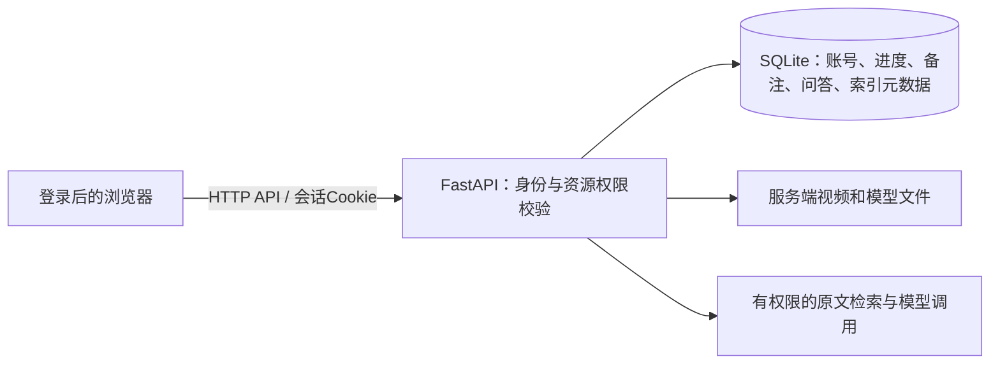

# 数据库方案与存储边界

## 推荐方案

本阶段继续用**后端SQLite＋SQLAlchemy**，用Alembic管理表结构变更。SQLite本身就是数据库，能够由FastAPI统一读写，浏览器通过API保存和读取记录。

根据[SQLite适用场景说明](https://www.sqlite.org/whentouse.html)，单实例、较低并发写入适合这一方案；大量并发写入、多应用实例时再评估PostgreSQL。这里的选型结论是结合当前课设和剩余时间作出的工程判断，不是SQLite性能测量结果。

| 方案 | 本项目取舍 |
| --- | --- |
| SQLite＋SQLAlchemy | 当前已接入，优先补账号和学习档案，不必为了“用数据库”再替换数据库 |
| PostgreSQL | 适合后续集中部署、多实例及更高写并发；不是本轮登录和保存功能的前置条件 |
| localStorage | 只保留界面偏好和短暂缓存；已登录学习档案以服务器成功保存的版本为准 |
| 独立向量数据库 | RAG不强制要求。本轮少量课程向量可存SQLite，用已有NumPy计算相似度，减少环境改造 |

数据库里的向量负责检索，账号和学习档案仍是关系数据。向量检索不能替代普通数据库的用户、进度、备注和事务管理。

## 当前与目标

| 数据 | 当前 | 目标 |
| --- | --- | --- |
| 视频文件 | 后端磁盘 | 仍在服务端磁盘，数据库记录路径和账号归属 |
| 视频、转写、章节 | SQLite已有 | 增加私有归属和版本核验 |
| 课程问答 | SQLite已有写入，无历史GET | 增加有权限的分页历史读取，刷新后恢复 |
| 用户与登录状态 | 尚未实现 | users与sessions；服务端校验会话 |
| 播放位置 | 没有服务端保存接口 | playback_progress；暂停、定时和离开时保存 |
| 已复习、待复习、备注、已解决 | 浏览器localStorage | review_records；按登录账号保存 |
| RAG块和向量 | 现有按窗口BM25，无语义向量 | 后端rag_chunks及chunk_embeddings，记录模型、维度、文本哈希和处理批次 |

## 同步的前提

换浏览器或设备恢复记录，必须连接**同一个后端和同一套数据库**。五个人各自克隆代码、各自运行一个app.db，不会自动共享数据。

当前服务只监听127.0.0.1，适合同机不同浏览器验证。先用该方式验收；需要多设备演示时，由卢乙源统一部署一个同源入口并配置访问地址。账号、进度和RAG索引仍只由该服务访问数据库，不让浏览器或其他电脑直接打开数据库文件。

## 表结构和旧数据迁移

数据库迁移统一由李沛丰集成，表及接口先按02冻结；许梓轩提供账号模型，卢乙源提供RAG字段需求。其他人不并行修改迁移链。不能指望`create_all()`自动给现有表补字段；SQLite的复杂表调整应按[Alembic批量迁移机制](https://alembic.sqlalchemy.org/en/latest/batch.html)处理。

迁移顺序：旧库结构基线→账号/会话/视频归属→学习档案→RAG数据及问答检索元数据。新库和现有库都要升级验证，先在副本执行并备份。

旧视频默认保持“未归属”，普通新用户不可见。不得将全部旧视频自动归给第一个注册者。组长确定演示账号后，SYS用有记录的维护动作认领指定视频；旧转写、章节和问答跟随视频归属。旧本地标记也不自动上传到刚登录的账号。

数据库、媒体与索引必须对应版本。重试处理会改变attempt和章节ID：旧标记保留为过期快照，不计入当前进度，不按相近时间强行套到新章节。删除自己的视频按既定规则清理关联数据和向量；本轮不做可恢复的云端回收站。

## 登录和保存的最低实现要求

账号使用用户名与密码，暂不加短信、第三方登录、找回密码或管理员页面。密码使用Argon2id哈希；登录用服务端随机会话和HttpOnly Cookie，不将登录凭据存入localStorage。依据见[FastAPI密码哈希说明](https://fastapi.tiangolo.com/tutorial/security/oauth2-jwt/)和[OWASP会话管理](https://cheatsheetseries.owasp.org/cheatsheets/Session_Management_Cheat_Sheet.html)。

服务端必须从会话确定用户，检查该用户是否拥有视频，之后才能读写原文、播放文件、记录和检索材料。隐藏前端按钮不等于实现权限。A账号拿到B的视频ID，所有相关接口也必须拒绝。

学习档案写入采用短事务，播放进度约15秒保存一次，暂停和正常离开时追加保存。页面显示“保存中/已保存/保存失败”，不能请求一发出就宣称成功。异常断网或强关页面可能丢失最后一小段未确认位置，不能承诺逐帧同步。

保存时带版本号，处理多页面旧数据覆盖；原始播放位置和“已复习”手动标记分开，拖到结尾不自动判定已掌握。退出或切换账号清空前端用户缓存、取消旧请求，避免账号串数据。
